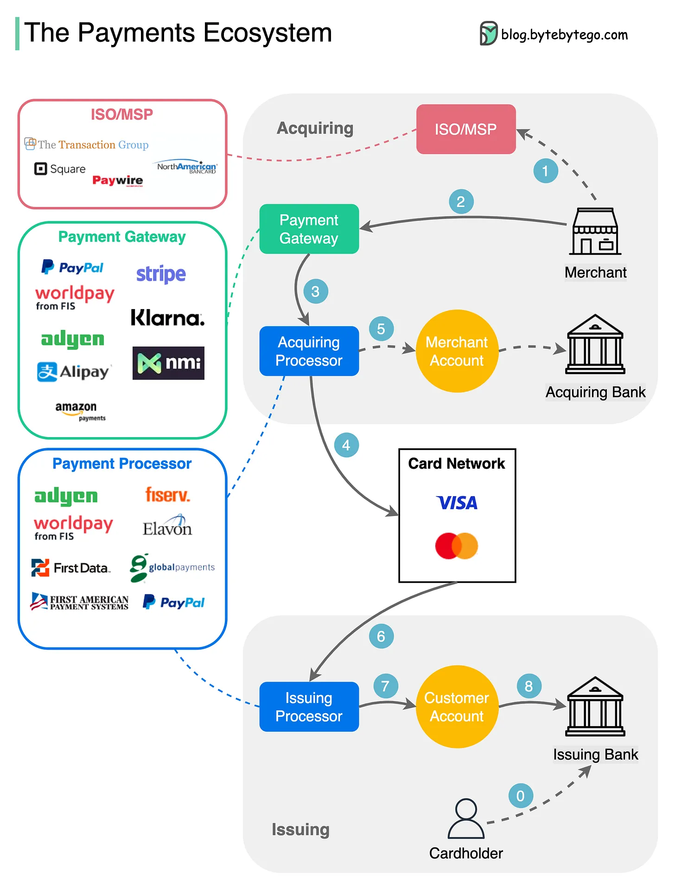
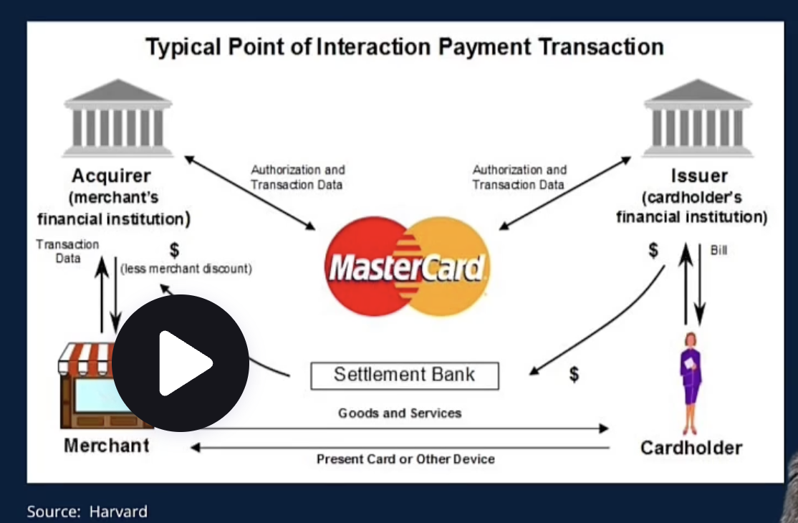
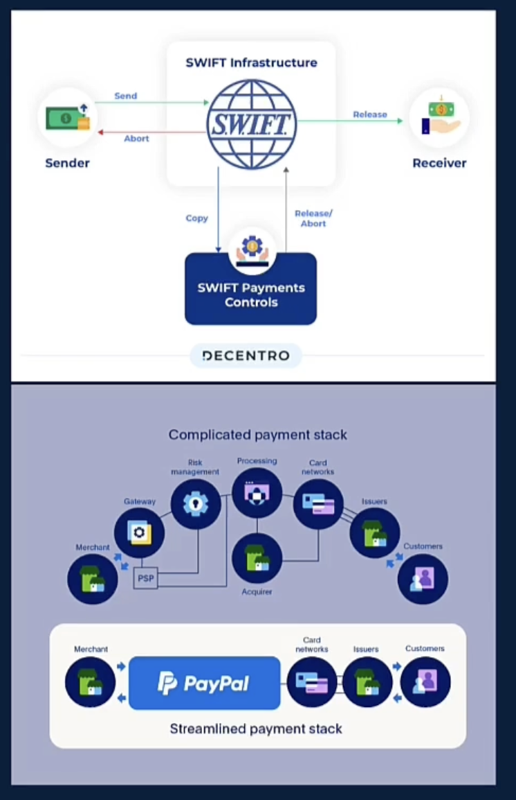

# Section 2:  Payments Ecosystem and Players

### What is the payment ecosystem   
The payment ecosystem is the hidden infrastructure enabling money to move - securely and efficiently - across businesses, people, and platforms.   
It encompasses a vast network of technologies, regulations, and financial institutions that work in concert to process every transactions.  
* Payments are not just simple money transfers; they are complex operations involving structured data and precise instructions that trigger the secure movement of funds.
* This robust infrastructure support an immerse range of transactions, from everyday small purchases like a $5 coffee or grocery bill to substantial transfers such as multi-million pound B2B payments.

### The key players in a payment
__Payer & Payee__  
The individuals  or entities sending and receiving funds. They interact with the payment systems through various interfaces.  
__Issuer & Acquirer__   
Financial institutions that serve payers and payees respectively, managing accounts and enabling access to payment networks.  
__Networks & Processors__  
Visa, Mastercard, and PSPs like Strip that route transaction data and ensure proper authorization and settlement. PSPs (Payment Service Providers).  
__Clearing & EMIs & MSBs__   
Clearing & settlement systems include BACS, SEPA, ACH and RTGS. EMIs (Electronic Money Institutions). MSBs(Money Services Businesses). RTGS(Real Time Gross Settlement)  
__Central Banks & Regulators__  
Central banks and regulatory authorities that maintain trust, stability and compliance throughout the ecosystem.

### Open-Loop Vs Closed-Loop Systems
__Open-Loop Systems__  
Multiple institutions coordinating via standard messaging protocols.
* Examples: Visa, Mastercard, SWIFT
* High interoperability across institutions
* Greater reach but potentially slower
* Shared standards and governance

__Closed-Loop Systems____
Self-contained ecosystems where one provider controls the entire flow
* Examples: PayPal, M-Pesa, AliPay
* Faster transaction processing
* Limited to platform participants  
* Centralised control and risk management

### The payment mindset - Asking better questions
* __Follow the flow__  
Every payment has a journey - identify who touched it, what rails it used, and who collected fees along the way.
* __Analyse economics__  
Who earned revenue from the transaction? What are the unit economics that make this payment profitable?
* __Examine infrastructure__  
What messaging formats and protocols enabled this transactions? Which clearing systems were involved?
* __Consider alternatives__  
Could this payment have flown differently? What would change the speed, cost or security profile?  

Understanding the flow of funds is a career superpower in banking and fintech.  

### Domestic vs Cross Border Payments
__Domestic Payments__  
* Typically settled within hours or minutes
* Low-cost or free to end users
* Single regulatory framework
* Examples: Faster Payments (UK), ACH (US)

__Cross-border Payments__  
* Can take 3-5 days to settle
* Higher fees (2-7% of transaction value)  
* Multiple regulatory jurisdictions
* FX conversion and correspondent banking

The same payment can involve radically different processes, cost and timeframes depending on whether it crosses national borders.  
